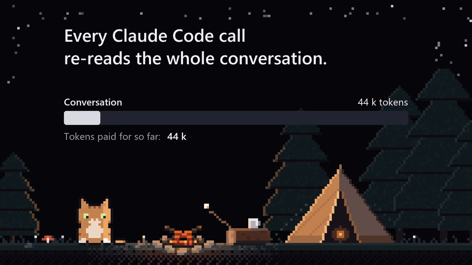
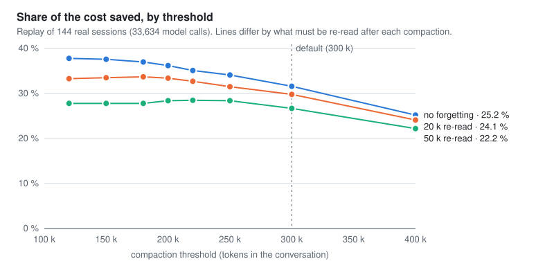
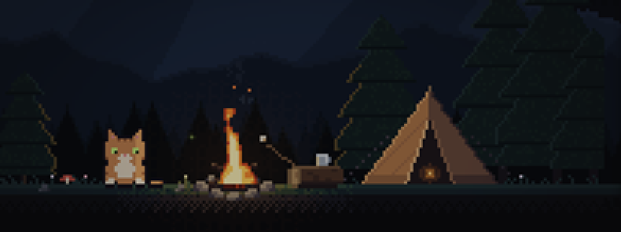

<div align="center">

# Seuil

**Automatic compaction for Claude Code: between two turns, once the conversation passes a threshold.**

Every model call re-reads the whole conversation, so a long session pays mostly for re-reading.<br>
Seuil keeps the conversation short without you thinking about it. *Seuil* is French for *threshold*.

[](LICENSE)
[](#install)
[](tests/seuil.test.ts)
[](paper/PAPER.md)

[](https://github.com/KorroAi/seuil/raw/main/docs/media/seuil-demo.mp4)

<sub>Seuil in 15 seconds. The compaction shown (366 k → 47 k) comes from a real session, the 30 % from the paper.
<a href="https://github.com/KorroAi/seuil/raw/main/docs/media/seuil-demo.mp4">Watch it in HD (1080p)</a>.</sub>

</div>

## Why

On 144 real sessions (30 days, 33,634 model calls), replayed with automatic compaction at 300 k tokens:

- **about 30 % of the total cost saved**, 27 % if each summary forgets 50 k tokens that must be read again;
- **about 20 %** for a user who already restarts long sessions by hand;
- **nothing** for sessions that stay short: all the gain is in long sessions.

Trimming tool outputs instead, the obvious idea, would save 0.1 % without loss and 5 % at most.
The method, the tables and the limits are in the [paper](paper/PAPER.md).
[`bench/simulate.mjs`](bench/simulate.mjs) runs the same replay on your own sessions.



## Install

At the prompt of a Claude Code terminal session:

```
/plugin install seuil --marketplace KorroAi/seuil
```

Answer `y` to add the marketplace, then pick a scope (user scope = every session). From a shell:

```
claude plugin install seuil --marketplace KorroAi/seuil
```

In the desktop app: click **+** next to the prompt box, then **Plugins**, **Add marketplace** with `KorroAi/seuil`,
then **Add plugin**.

Seuil uses the Claude Code mod API (function hooks), which is in early access. Checked on Claude Code 2.1.325.

## What it does

- At the end of each turn it reads the real size of the conversation from Claude Code.
- Above the threshold (**300 k tokens** by default) it starts Claude Code's own compaction, with instructions that
  ask the summary to keep the goal, every decision and correction you gave (quoted), the exact state of the work,
  the files with their paths, what remains to do, and the pitfalls met.
- It never compacts in the middle of a turn or inside a subagent.
- It does not start again right after a compaction that left the conversation close to the threshold: then it
  waits until the conversation has grown back by half.
- On a model whose context window is smaller than the setting, the threshold drops to 75 % of the window.
- You always see where you are, live, even during a long turn. In the terminal, at the end of the hint line under
  the prompt:

  ```
  ? for shortcuts · Seuil · 182 k / 300 k · last compaction 341 k → 64 k
  ```

  In the desktop app and remote sessions, as the plugin's status line. Each compaction also leaves a line in the
  transcript.
- In a headless session (`claude -p`, an SDK host) it goes through `/compact`, since direct compaction is not
  available there yet.

| Command | Effect |
|---|---|
| `/seuil` | status, last compaction, total taken out since install |
| `/seuil 250` | sets the threshold to 250 k (minimum 100 k) |
| `/seuil now` | compacts as soon as the turn ends |
| `/seuil off`, `/seuil on` | switches automatic compaction off or on |

The model also gets a `diagnostic` tool that reports the real state read from the engine.

## Measure it on your own sessions

```
node bench/simulate.mjs        # the last 30 days
node bench/simulate.mjs 60     # the last 60 days
```

It reads `~/.claude/projects` without changing anything and sends nothing anywhere. Projects are numbered, never
named, so the output can be shared. Node 18 or newer, no dependency.

## The Campfire theme (Windows Terminal, optional)

A night landscape in pixel art, drawn by a shader behind the text: starry sky, shooting stars, mountains, forest,
and a camp with a fire and a cat that sits, blinks and falls asleep. It stays dark and in the back, fades out under
text, and never passes under the line you type in. It is the background of the demo above.



```
node theme/install.mjs               # adds a "Seuil · Campfire" profile to the new-tab menu
node theme/install.mjs --everywhere  # applies it to every Windows Terminal profile
node theme/install.mjs --remove      # removes everything it added
```

A copy of Windows Terminal's settings is kept before the first change (`settings.json.before-seuil-theme`).
The theme uses Windows Terminal's experimental pixel shader settings; it was checked on Windows Terminal 1.24.
Other terminals (VS Code, macOS, Linux) have no pixel shaders: the theme is Windows Terminal only, the mod works
everywhere Claude Code runs.
Everything is code: [`paint.mjs`](theme/campfire/paint.mjs) paints the camp, [`campfire.hlsl`](theme/campfire/campfire.hlsl)
draws the rest and animates it.

## Limits

- A compaction loses detail. The instructions limit the damage, they do not remove it.
- It happens only between turns: a long agentic turn can grow well past the threshold before it ends.
- It takes time: 45 to 58 s in real sessions.
- The savings come from a simulation on one heavy user's sessions; see the paper for what it does not cover.

## Develop

```
claude --plugin-dir .          # run Claude Code with this folder as a mod
claude plugin test .           # 15 tests
claude plugin validate .
```

What changed between versions: [CHANGELOG.md](CHANGELOG.md).

## License

[MIT](LICENSE)
