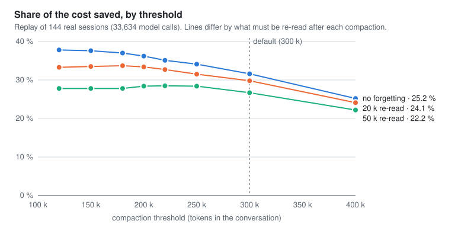

# Where the money goes in a long Claude Code session, and what actually cuts it

*A measurement on 144 real sessions, a negative result, and a small mod. November 2026.*

## Abstract

In an agentic coding session every model call re-reads the whole conversation. We replayed 30 days of one
heavy user's recorded Claude Code sessions (144 sessions, 33,634 model calls) to find what drives their cost
and which lever reduces it. Trimming tool outputs, the obvious idea, would save **0.1 %** losslessly and at
most **5.2 %** of the cost even with aggressive, lossy cuts. Compacting the conversation automatically once it
passes a threshold would have saved **27 to 38 %** of the total cost, depending on how much the summary forgets,
and about **20 %** over the most recent half of the period. The saving is flat between 150 k and 250 k tokens.
We built that lever as a Claude Code mod, **Seuil**, checked it with unit tests, a scripted headless run and six
compactions in ordinary working sessions, and publish the replay script so anyone can measure their own sessions.

## 1. Data and cost model

**Data.** Every session of one user over 30 days that holds at least 200 KB of transcript and 5 model calls:
144 sessions, 33,634 calls, across 8 projects (video production, games, tooling). For each call we read the
real usage the API reported: uncached input, cache read, cache write (1 h and 5 min), output, and whether the
call opens a turn (the first call after a message from the person). Subagent calls are left out.

**Cost unit.** 1 = the price of one input token. Cache read 0.1, cache write 1 h 2, 5 min 1.25, output 5.
These are Anthropic's usual price ratios; if they change, the results move.

With those ratios the real cost splits into **cache reads 71.8 %, cache writes 15.7 %, output 12.5 %**.
The first call of a session already carries 66 k tokens (median): system prompt, tools, memory files.
Sessions that pass 300 k tokens of context are 94 of 144 but **95.7 % of the cost**.

## 2. A negative result: trimming what enters the conversation

The first plan was a mod that trims tool outputs as they enter: exact duplicates, noise, then lossy cuts
where the arithmetic says they pay. We replayed the sessions to see what it would have removed, weighting each
token by the number of times it is re-read afterwards.

Where the re-read volume comes from:

| Source | Share of re-read volume |
|---|---|
| Claude's own answers (text, tool calls, files written) | 26.3 % |
| Tool results | 24.3 % |
| Base context (system prompt, tools, first message) | 19.9 % |
| Images | 15.2 % |
| Claude's thinking | 13.9 % |
| The person's messages | 1.7 % |

What trimming would have removed:

| Lever | Share |
|---|---|
| Exact duplicates | 0.0 % of volume |
| Noise, lossless | 0.1 % |
| Lines equal up to numbers | 0.3 % |
| Every lossy cut, upper bound, assuming the model never asks again | 6.3 % of volume, **5.2 % of cost** |

Tool results are only a quarter of the volume, so even deleting all of them could not save much. We stopped there.

## 3. The lever that works: compacting at a threshold

**Simulation.** At each turn boundary, if the context passes the threshold, the conversation is compacted.
A compaction costs the summarizer reading the whole context (from cache, or at full price after a pause of more
than an hour, when the cache has expired), writing the summary, and writing what remains back to cache. It brings
the context back to the size really observed after the 85 compactions already present in the data (90 k,
median), plus a "forgetting" term: tokens the agent has to read again because the summary dropped them. Every
real call is then replayed with the lighter context: what was removed is no longer read or written.

| Threshold | Forgetting 0 | Forgetting 20 k | Forgetting 50 k | Compactions |
|---|---|---|---|---|
| 120 k | 37.8 % | 33.3 % | 27.8 % | 829 |
| 150 k | 37.6 % | 33.5 % | 27.8 % | 572 |
| 180 k | 37.0 % | 33.7 % | 27.8 % | 458 |
| 200 k | 36.2 % | 33.4 % | 28.4 % | 402 |
| 220 k | 35.1 % | 32.7 % | 28.5 % | 356 |
| 250 k | 34.1 % | 31.5 % | 28.4 % | 307 |
| **300 k** | **31.6 %** | **29.8 %** | **26.7 %** | **221** |
| 400 k | 25.2 % | 24.1 % | 22.2 % | 143 |

**How much does a summary forget?** We measured it on the 75 real compactions that had enough calls after them:
the extra growth of the context over the next 20 calls, compared with before, is **9 k tokens in median, 30 k in
mean** (quartiles −9 k and 45 k). The 20 k column is the realistic one.

**Robustness** (300 k, forgetting 20 k):
- Per session: worst −20.5 %, median +7.0 %, best +53.4 %. 5 sessions of 144 lose; 69 gain more than 10 %.
- Sessions that never pass 300 k gain nothing (they are 4.3 % of the cost). All the gain is in long sessions.
- Per project: from 20 % to 37 %, all positive.
- **First half of the period: 33.5 %. Second half: 19.0 %.** In the second half the user had started restarting
  sessions by hand from a written note, which takes part of the gain already. **About 20 % is the honest figure
  for someone who already manages their context; about a third for someone who does not.**

**Choosing the threshold.** Between 150 k and 250 k the saving is the same within a point. Lower thresholds
compact far more often (829 times at 120 k against 221 at 300 k) for nothing. The mod ships with 300 k: about
3 points less than the best, for 40 % fewer compactions, so less detail is lost along the way. The user can set
any value from 100 k.

## 4. What does not add anything

**Compacting when coming back from a pause.** After a pause of more than an hour the cache has expired and the
whole context is written again at full price. Those cold restarts weigh 3.5 % of the cost. Compacting at that
moment saves 4 to 5 % on its own, but **nothing once the threshold is in place** (at 180 k: 33.4 % with it, 33.7 % without). Left out.

**Other levers measured, not built:**

| Lever | Saving alone | Note |
|---|---|---|
| Images read at 1024 px instead of full size | 7.2 % | lossy; overlaps with compaction |
| Images read at 768 px | 9.7 % | same |
| 10 k tokens less of system prompt and tools | 1.9 % | free; the base is re-read on every call |
| Files Claude writes in full (Write) | 10.6 % of cost | re-read on every later call; no simple lever |

## 5. The mod

Seuil is a Claude Code mod (a plugin of function hooks, early-access API). In short:

- At the end of each turn of the main conversation, it reads the real context size from the engine.
- Above the threshold, it starts the engine's own compaction on a timer, outside the hook, so the turn end is
  never held. Instructions ask the summary to keep the goal, every decision and correction of the user (quoted),
  the exact state of the work, the files with their paths, what remains, and the pitfalls met.
- It never compacts inside a turn or a subagent, and never twice in a row: the conversation must grow back by
  half of its post-compaction size first. Two turn ends close together schedule one compaction.
- The engine refuses to compact while a turn runs: Seuil retries every 2 s for a minute, then stays quiet until
  the next turn end.
- In a headless session (`claude -p`, an SDK host) the engine does not offer direct compaction yet; Seuil
  detects it and goes through the `/compact` command instead.
- It records every compaction, including those it did not start (`/compact`, the engine's own), so it knows
  where it starts from.
- The size after a compaction is measured by the mod at the next fresh reading, not taken from the engine: the
  engine's figure leaves out the system prompt and tools (8 k reported, 42 k real in our run), and it reads 0 right
  after a compaction.
- On a model whose context window is too small for the setting, the threshold drops to 75 % of the window. This
  rule is newer than the simulation and was not replayed.

## 6. Checks

**Unit tests.** 10 tests run against the engine's test host (`claude plugin test`): threshold, aborted turns and
subagents, retries, refusals, commands, double turn ends, broken readings, migration of old settings, the window
cap, the diagnostic tool, the headless road, and compactions coming from elsewhere.

**Scripted run, headless.** A separate Claude Code session on Haiku, with a copy of the mod whose threshold was
lowered to 30 k, two one-line messages. Six runs, USD 0.10 in all. They taught four things the tests had not:
the headless refusal and its message, the engine's wrong size after a compaction, the 0 reading right after, and
a double compaction on two close turn ends (fixed). In the last run the mod compacted on its own at the end of the
first turn; the engine attests it (`compact_boundary`, 36,519 tokens before, 9 s), there was one compaction and no
loop, and the model then answered a question about a fact given before the compaction.

**In ordinary work.** On 14 November 2026 the mod ran in the user's normal interactive sessions. It compacted six
times on its own in three sessions, each attested by the engine:

| Before | After (next call) | Duration |
|---|---|---|
| 381 k | 85 k | 46 s |
| 306 k | 92 k | 58 s |
| 346 k | 74 k | 49 s |
| 581 k | 88 k | 56 s |
| 498 k | 88 k | 45 s |
| 453 k | 93 k | 51 s |

The context came back to 74–93 k each time, close to the 90 k the simulation assumes.

## 7. Limits

- **The simulation assumes the work goes on the same after a compaction.** A mistake caused by a lost detail is
  not counted; the forgetting measure in section 3 is the only real proxy.
- **One user.** 144 sessions of one heavy user with long sessions on a 1 M-token window. Someone whose sessions
  stay short gains nothing.
- **A compaction happens only between turns.** A long agentic turn can pass the threshold far before it ends:
  four of the six real compactions started above 450 k.
- **A compaction takes time:** 45 to 58 s in the real sessions above.
- **Price ratios are an assumption** (section 1).
- **The mod API is in early access** and may change. Checked on Claude Code 2.1.325.

## Reproduce

`node bench/simulate.mjs` replays your own sessions from `~/.claude/projects` (read-only, nothing is sent
anywhere) and prints the same tables for you. The numbers above come from the run of 14 November 2026.
